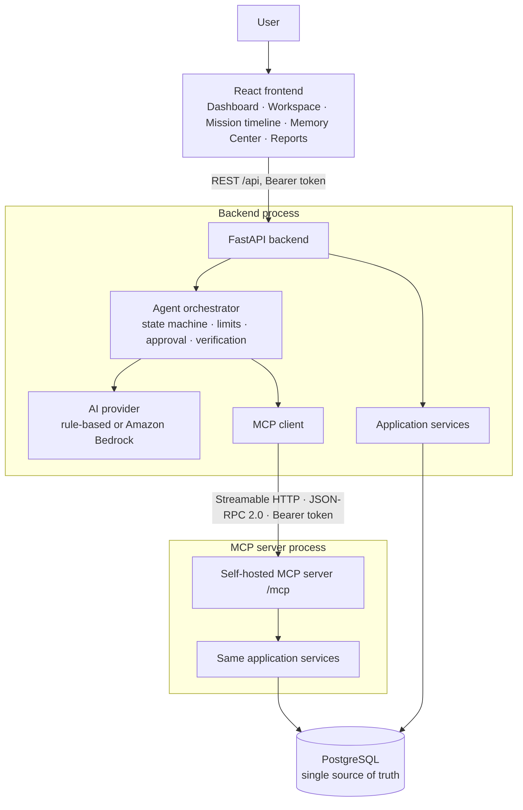
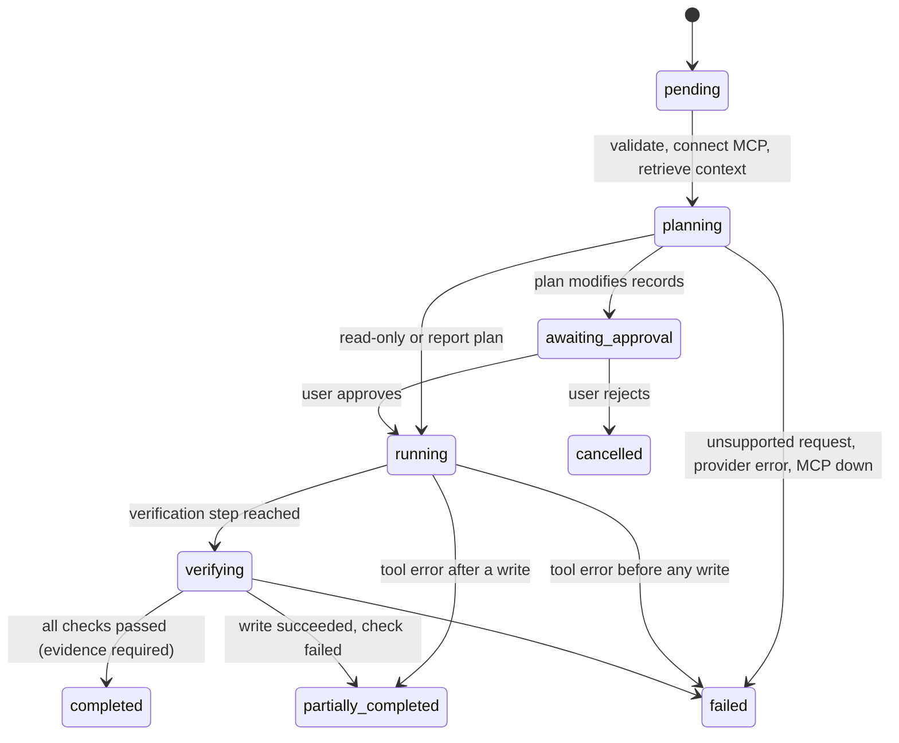
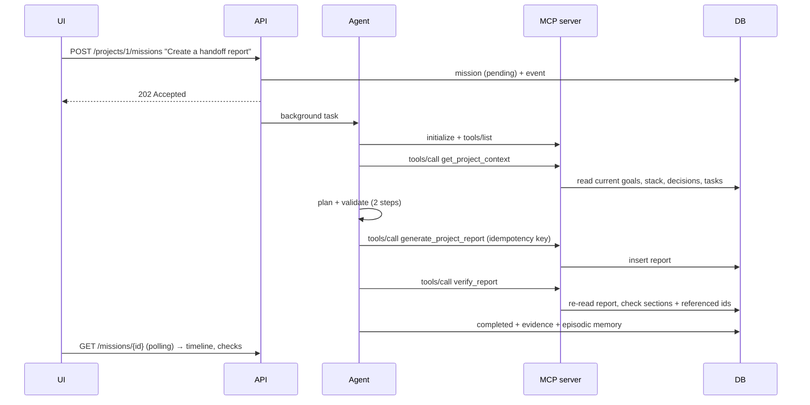
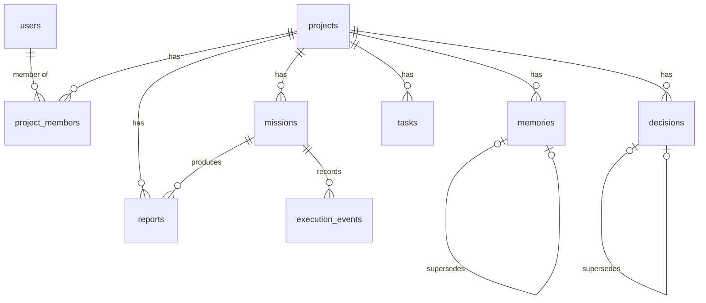

# Architecture

## 1. System overview

Two processes share one codebase (`backend/app/services`) and one database. The REST API serves the UI; the MCP server serves tool calls. The agent lives in the backend and reaches the database for tool work **only** through the MCP server, so anything the agent does can also be done and audited by any other MCP client.

## 2. Components

| Component | Path | Responsibility |
|---|---|---|
| Frontend | `frontend/src` | Presentation only. Never trusted for authorization. Polls missions for a live timeline. |
| REST API | `backend/app/api/routes.py` | Projects, memories, decisions, tasks, missions, approvals, reports, status. Starts missions as background tasks. |
| Orchestrator | `backend/app/agent/orchestrator.py` | Context → plan → validate → approval → execute → verify → record outcome. Writes a timeline event per real operation. |
| State machine | `backend/app/agent/state.py` | Allowed transitions; refuses Completed without verification evidence. |
| Providers | `backend/app/agent/providers.py` | `RuleBasedProvider` (default, deterministic) and `BedrockProvider` (Converse API). Output is always validated. |
| MCP client | `backend/app/mcp_client/client.py` | Streamable HTTP session, initialize, tools/list, tools/call with timeouts; maps outages to `MCPUnavailable`. |
| MCP server | `backend/app/mcp_server/server.py` | 8 tools; auth from HTTP header; membership and approval checks; structured results and `isError` errors; audit log. |
| Services | `backend/app/services/*` | Memory, decisions, tasks, context, report generation and verification, auth. |
| Models | `backend/app/models/__init__.py` | SQLAlchemy models; Alembic migration in `backend/migrations`. |

## 3. Mission lifecycle

### Sequence: handoff report

## 4. Data model

| Table | Key fields |
|---|---|
| users | name, token_hash (SHA-256) |
| projects / project_members | name, description, owner; membership is the authorization boundary |
| memories | memory_type, content, source, status (active/superseded), confirmation, tags, supersedes_id, mission_id |
| decisions | title, description, status (confirmed/proposed/superseded), supersedes_decision_id |
| tasks | title, status (open/in_progress/blocked/done), priority, idempotency_key (unique per project), completed_at |
| missions | request, mission_type, status, plan (JSON), requires_approval, approved_at, result_summary, error, tool_calls |
| execution_events | seq (unique per mission), event_type, description, tool_name, result (bounded JSON), verification_status |
| reports | title, content, required_sections, verification_status, verification_details, idempotency_key (unique per project) |

Integrity is enforced in both layers: foreign keys and unique constraints in the database; membership, approval, supersession and state-transition rules in the services.

## 5. Security model

| Control | Where |
|---|---|
| Authentication | Bearer token on every API and MCP request; hashes only in the database (`services/auth.py`). |
| Authorization | `require_project` on every operation; the MCP server re-checks independently of the backend. |
| Approval | MCP write tools refuse to run without an approved, running mission owned by the caller. |
| Plan safety | Orchestrator rejects unknown tools, forces `project_id`, requires verification after writes, sets `requires_approval` itself. |
| Untrusted content | Memories and tool output are passed as data; the rule-based planner reads only the user’s request; Bedrock prompt marks context as data; tests cover an injected instruction. |
| Secrets | `.env` is git-ignored; `.env.example` has placeholders; status endpoint and UI never return secrets. |
| Audit | Every mission step is an `execution_events` row; the MCP server logs tool, user, project and outcome (no content). |

## 6. Deployment

Local: PostgreSQL via `docker compose up -d db`, then the three run scripts. Any container platform works by running the MCP server and the API as two services pointing at the same `DATABASE_URL`, with `MCP_SERVER_URL` set to the MCP service’s internal URL, and the built frontend (`frontend/dist`) served by any static host that proxies `/api` to the API. When the MCP server listens on a non-localhost host name, configure the SDK’s transport-security allowed hosts accordingly.
